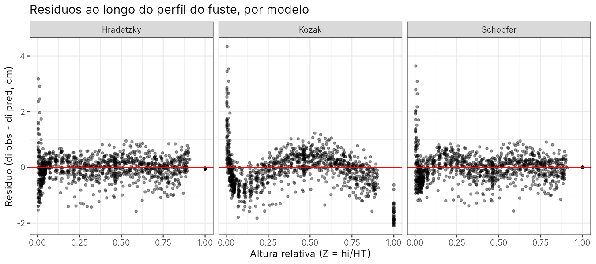
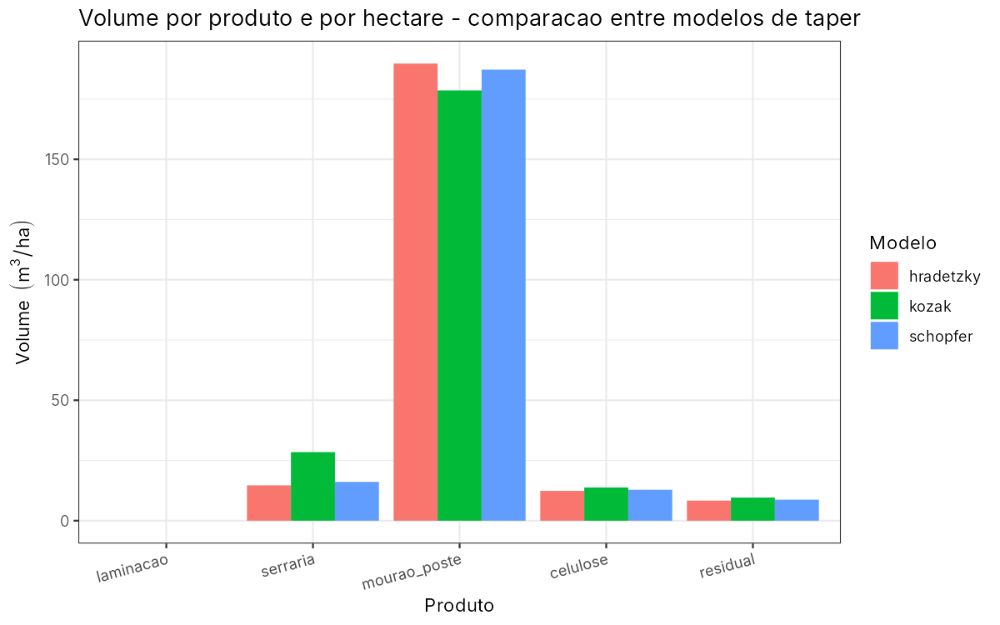

<div align="center">

# 🌲 Desafio 05 — Taper e sortimento

**Modelos de afilamento do fuste e sortimento multiproduto**

   

*Disciplina Mensuração Florestal · Programa de Pós-Graduação em Ciências Florestais · ICA/UFMG*

</div>

## 📋 Objetivo

Ajustar e comparar modelos de taper com as árvores cubadas e aplicá-los ao inventário para estimar o sortimento de madeira por produto e por hectare.

## 🗂️ Dados

- [`dados/cubagem.xlsx`](dados/cubagem.xlsx): 36 árvores cubadas (1.125 seções).
- [`dados/inventario_completo.xlsx`](dados/inventario_completo.xlsx): 215 árvores com altura medida ou estimada ([Desafio 02](https://github.com/danieldias936-cyber/desafio-02-altura)).

## 🔧 Métodos

- Modelos ajustados por mínimos quadrados, com Z = hi/HT:
  - **Kozak (1969):** polinômio de 2º grau em (di/DAP)²
  - **Schöpfer (1966):** polinômio de 5º grau em di/DAP
  - **Hradetzky (1976):** polinômio de potências fracionárias
- Seleção por R², R² ajustado, Syx% e análise gráfica de resíduos.
- Volume por produto obtido pela integração do perfil e segmentação do fuste em toras.

## 📈 Principais resultados

| Modelo | R² ajustado | Syx (%) |
|---|:-:|:-:|
| Kozak (1969) | 0,9776 | 6,42 |
| Schöpfer (1966) | 0,9894 | 4,42 |
| **Hradetzky (1976)** | **0,9909** | **4,09** |

Sortimento por hectare com o modelo de Hradetzky:

| Produto | Toras/ha | Volume (m³/ha) |
|---|:-:|:-:|
| Serraria | 209 | 14,7 |
| Mourão e poste | 6.148 | 189,8 |
| Celulose | 1.204 | 12,4 |
| Resíduo | — | 8,3 |

- O Kozak tem resíduos com padrão sistemático ao longo do fuste e superestima em 94% o volume de serraria em relação ao Hradetzky.

<p align="center">
  <br>
  <sub><b>Resíduos dos modelos de taper ao longo da altura relativa</b></sub>
</p>

<p align="center">
  <br>
  <sub><b>Volume por produto segundo cada modelo</b></sub>
</p>

## 📁 Estrutura do repositório

```text
desafio-05-taper-e-sortimento/
├── dados/
│   ├── cubagem.xlsx
│   └── inventario_completo.xlsx
├── scripts/
│   ├── 00_funcoes_taper.R      # funções de taper, integração e toreamento
│   ├── 01_ajuste_taper.R       # etapa 1: ajuste e seleção
│   └── 02_sortimento.R         # etapa 2: sortimento por hectare
├── resultados/
│   ├── tabelas/                # coeficientes, sortimento, comparação
│   └── figuras/
└── docs/
    ├── relatorio.md
    └── metodologia_detalhada.md
```

## ▶️ Como executar

A partir da raiz do repositório:

```r
install.packages(c("readxl", "dplyr", "ggplot2"))
```

```bash
Rscript scripts/01_ajuste_taper.R
Rscript scripts/02_sortimento.R
```

## 📄 Documentos

- 📊 [Relatório](docs/relatorio.md)
- 🔍 [Metodologia detalhada](docs/metodologia_detalhada.md)

## 🧭 Série de desafios

| # | Desafio | |
|:-:|---|:-:|
| 01 | [Diâmetro](https://github.com/danieldias936-cyber/desafio-01-diametro) | |
| 02 | [Altura e relação hipsométrica](https://github.com/danieldias936-cyber/desafio-02-altura) | |
| 03 | [Volume e forma](https://github.com/danieldias936-cyber/desafio-03-volume-e-forma) | |
| 04 | [Volume reduzido e equações de volume](https://github.com/danieldias936-cyber/desafio-04-volume-reduzido-e-tabela) | |
| **05** | **Taper e sortimento** | 📍 você está aqui |
| 06 | [Amostragem de Bitterlich](https://github.com/danieldias936-cyber/desafio-06-bitterlich) | |
| 07 | Classificação de sítios florestais | ⏳ |
| 08 | [Validação do índice de sítio](https://github.com/danieldias936-cyber/desafio-08-validacao-sitio) | |
| 09 | [Crescimento e produção (Clutter)](https://github.com/danieldias936-cyber/desafio-09-modelo-clutter) | |

## 👤 Autor

**Daniel Dias** · [@danieldias936-cyber](https://github.com/danieldias936-cyber)  
Mestrado em Ciências Florestais — ICA/UFMG, Montes Claros (MG)
